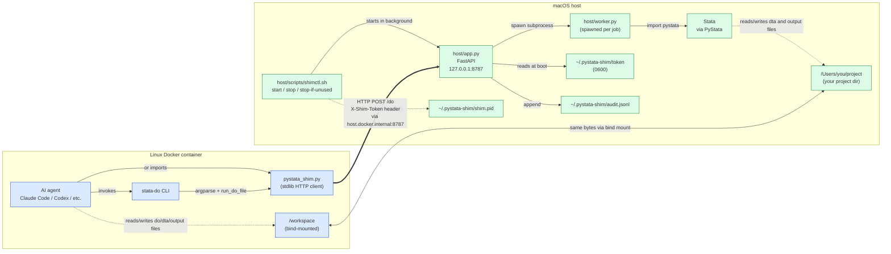
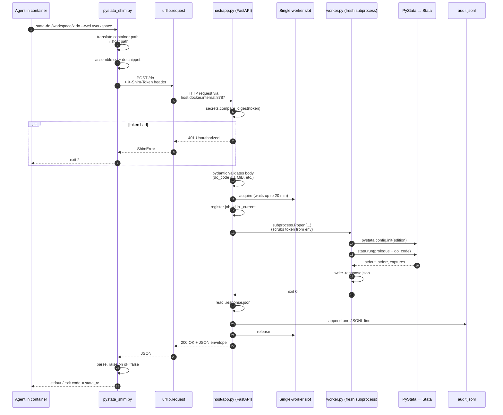
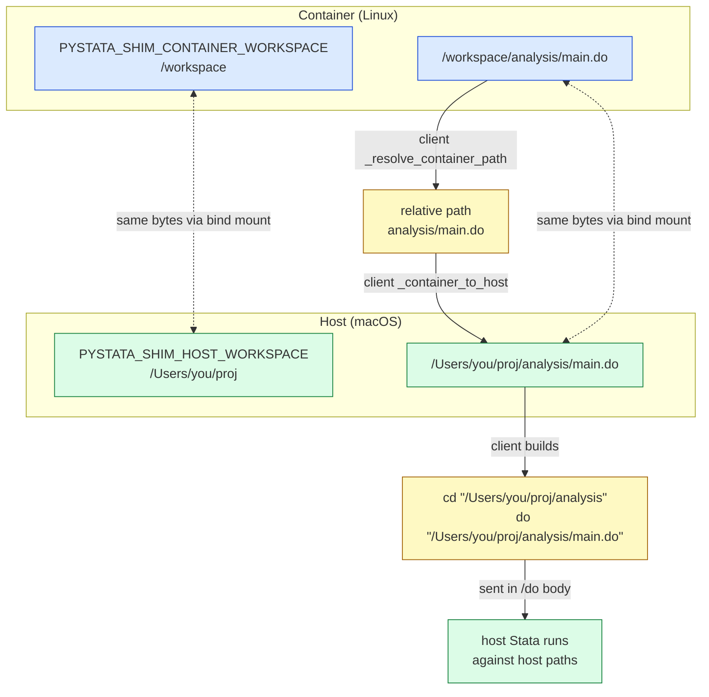
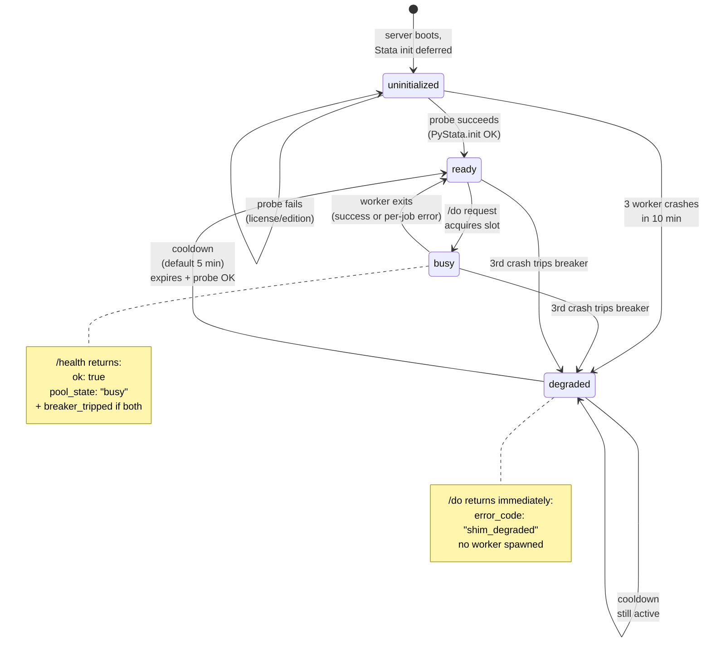
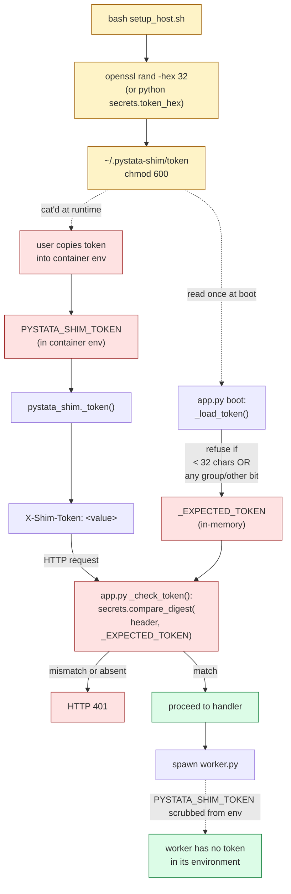

# Diagrams

Five Mermaid diagrams that answer a single question each. GitHub
and most modern markdown viewers render them inline; if your
viewer doesn't, paste the source block at https://mermaid.live/.

If you only have one minute, read **Diagram 1**. It's the whole
picture.

1. [What sits where, who talks to whom](#1-architecture-overview)
2. [What happens when an agent calls `stata-do`](#2-request-lifecycle)
3. [How a container path becomes a host path](#3-path-mapping)
4. [How the shim's `pool_state` transitions](#4-state-machine)
5. [How the shared-secret token flows end-to-end](#5-auth-flow)

---

## 1. Architecture overview

Question: where do the pieces live, and what crosses the
boundary?

The container session and the shim run together: a wrapper recipe
(see `examples/justfile/Justfile` or `examples/docker-run/run.sh`)
calls `shimctl start` before the container starts and
`shimctl stop-if-unused` after it exits, so the shim is up only
while a labeled container needs it.

Reading rules:

- **Solid arrows** are control flow (function calls, signals,
  HTTP requests).
- **Dotted arrows** are data flow on shared storage (the bind
  mount, output files).
- **Double arrow** (`==>`) is the network boundary. It's the
  only edge that crosses from container to host. Everything else
  is in-process or on shared disk.
- The container holds **no Stata license** and never imports
  PyStata. The host runs Stata exactly once per job and never
  exposes anything beyond `127.0.0.1:8787`.

---

## 2. Request lifecycle

Question: what happens, in order, when an agent runs
`stata-do my_analysis.do`?

What can go wrong at each step:

| step | failure | shim returns                 |
|------|---------|------------------------------|
| 5    | bad token | HTTP 401, `ShimError`        |
| 6    | bad body  | HTTP 422, FastAPI default    |
| 7    | slot held >20 min | `error_code: "queue_timeout"` |
| 9    | timeout fires | SIGTERM→SIGKILL, `error_code: "timeout"` |
| 9    | `/cancel` arrives | `error_code: "job_interrupted"` |
| 10   | license init failed | `error_code: "license_error"` |
| 14   | worker exits != 0 | `error_code: "stata_crash"`  |
| 14   | 3rd crash in 10 min | trips breaker → `shim_degraded` |

---

## 3. Path mapping

Question: I write `.do` paths inside the container; the host runs
Stata. How do those paths line up?

Three rules this enforces:

1. The client only translates paths under
   `PYSTATA_SHIM_CONTAINER_WORKSPACE`. Anything else raises
   `ShimError` — there is no silent fallback to `/tmp` or `/Users`.
2. The container and host workspace paths must be **the same
   bytes through a single bind mount**. Overlapping or nested
   binds are unsupported.
3. The `cd` and `do` lines that reach Stata always use the host
   path. Inside `.do` code, write outputs with paths *relative to
   the working directory*, never absolute container paths like
   `/workspace/output/...`.

---

## 4. State machine

Question: what does `pool_state` mean, and how does it change?

What unauthenticated `/health` shows in each state:

| state          | unauth `/health`                                            |
|----------------|-------------------------------------------------------------|
| uninitialized  | `{"ok": false, "pool_state": "uninitialized", "queue_depth": N}` |
| ready          | `{"ok": true,  "pool_state": "ready",         "queue_depth": N}` |
| busy           | `{"ok": true,  "pool_state": "busy",          "queue_depth": N}` |
| degraded       | `{"ok": false, "pool_state": "degraded",      "queue_depth": N}` |

Authenticated `/health` adds `edition`, `stata_version_number` when
known, `error_code`, `init_error`, and `current_job_id` (when busy).

Thresholds are env-tunable:
`PYSTATA_SHIM_DEGRADE_CRASHES` (3),
`PYSTATA_SHIM_DEGRADE_WINDOW_SEC` (600),
`PYSTATA_SHIM_DEGRADE_COOLDOWN_SEC` (300).

---

## 5. Auth flow

Question: how does the shared-secret token get from generation
to the comparison on every request?

Boot-time refusals enforced in `_load_token()`:

- **token unset** → `sys.exit(2)`, server never binds the port.
- **token < 32 chars** → `sys.exit(2)`.
- **token file has any group/other permission bit** →
  `sys.exit(2)` with a `chmod 600` hint.

Per-request:

- comparison is `secrets.compare_digest` (constant-time).
- mismatch returns 401 before any handler logic runs.
- successful auth proceeds to the typed pydantic body parser.

Per-spawn:

- the worker subprocess inherits *every* env var **except**
  `PYSTATA_SHIM_TOKEN`. If an operator explicitly enables
  `PYSTATA_SHIM_ALLOW_UNSAFE_DO=1` and a `.do` file runs `shell env`,
  the token still is not present in that child process environment.

---

## Where these diagrams come from in the code

| diagram | source files                                              |
|---------|-----------------------------------------------------------|
| 1       | `host/app.py`, `host/worker.py`, `client/pystata_shim.py` |
| 2       | `host/app.py` (`StataSupervisor._invoke_worker`, `_finalize`) |
| 3       | `client/pystata_shim.py` (`_resolve_container_path`, `_container_to_host`, `_stata_quote`, `run_do_file`) |
| 4       | `host/app.py` (`StataSupervisor.status`, `_record_crash`, `_is_degraded`) |
| 5       | `host/app.py` (`_load_token`, `_check_token`), `host/scripts/setup_host.sh` |
